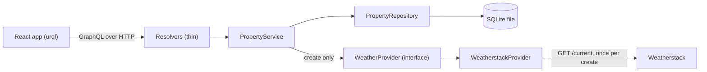

# US Property Records

This application keeps records of US properties. When a property is created, it stores the current weather, latitude and longitude returned for its location. The weather is a snapshot from creation, and queries never call Weatherstack.

1. Query all properties.
2. Sort properties by date of creation.
3. Filter the list by city, zip code and state.
4. Query the details of one property.
5. Add a property (all properties are in the US).
6. Delete a property.

## Run it

Use Node.js 24, as specified in `.nvmrc`. Create `.env` from `.env.example` and set `WEATHERSTACK_API_KEY` there. No Docker or cloud account is needed.

```sh
npm install
cp .env.example .env     # then put the Weatherstack key in .env
npm run dev              # API on http://localhost:4000/graphql (with GraphiQL), web on http://localhost:5173
```

`npm run dev` keeps running until it is stopped with Ctrl+C.

The local API with GraphiQL is at http://localhost:4000/graphql. The web app is at http://localhost:5173.

## Test it

`npm run verify` runs format check, codegen, lint, typecheck, unit and integration tests, and the web build. It does not need the application to be running.

```sh
npm run verify
```

`npm run e2e` runs Playwright.

```sh
npm run e2e
```

| Layer                  | What                                                                                                                                                                | How                                              |
| ---------------------- | ------------------------------------------------------------------------------------------------------------------------------------------------------------------- | ------------------------------------------------ |
| Input rules            | Valid and invalid inputs and filters, trimming                                                                                                                      | Vitest, pure functions                           |
| Weather adapter        | Success with string coordinates, each mapped error code in the body, at any HTTP status, HTTP 429, 5xx, timeout, unreadable body, missing location, key never leaks | Vitest with a stub `fetch` and recorded fixtures |
| Service and repository | Create, list with every filter combination, both sort orders, delete, not found                                                                                     | Vitest, real SQLite in `:memory:`, fake provider |
| GraphQL API            | All six stories, error codes and field errors, failed weather stores nothing, zero-provider-calls proof                                                             | Vitest, in process through `yoga.fetch`, no port |
| Web                    | Form validation and error display, filter and sort to URL, list states, delete confirmation, empty-list refresh                                                     | Vitest, Testing Library, `msw`                   |
| End to end             | Six stories against the API, a temporary database and a local Weatherstack stub                                                                                     | Playwright                                       |
| Real service           | One create against the real Weatherstack, made once by hand at the end of the project, with evidence saved without the key                                          | Manual, not a reader step                        |

No automated test, development loop or CI job calls the real Weatherstack service.

## Environment variables

Configuration is parsed at start-up. A missing `WEATHERSTACK_API_KEY` or a malformed value of any variable stops the process with a message that names the variable and never its value; every other variable falls back to the default in the table.

| Variable                | Default                        | Notes                                                 |
| ----------------------- | ------------------------------ | ----------------------------------------------------- |
| `WEATHERSTACK_API_KEY`  | None, required                 | Never logged or committed                             |
| `WEATHERSTACK_BASE_URL` | `https://api.weatherstack.com` | Configurable so end-to-end tests can use a local stub |
| `WEATHER_TIMEOUT_MS`    | `5000`                         |                                                       |
| `PORT`                  | `4000`                         |                                                       |
| `DATABASE_PATH`         | `./data/properties.db`         | Git-ignored                                           |
| `LOG_LEVEL`             | `info`                         |                                                       |

## Example GraphQL operations

Each operation can be pasted into GraphiQL. Replace `REPLACE_WITH_REAL_ID` in the detail and delete examples with a real property id.

List all properties:

```graphql
query ListProperties {
  properties {
    id
    street
    city
    state
    zipCode
    createdAt
  }
}
```

Sort properties oldest first:

```graphql
query SortPropertiesOldestFirst {
  properties(sort: CREATED_AT_ASC) {
    id
    street
    city
    state
    zipCode
    createdAt
  }
}
```

Filter by city, state and zip code:

```graphql
query FilterProperties {
  properties(filter: { city: "Fountain Hills", state: AZ, zipCode: "85268" }) {
    id
    street
    city
    state
    zipCode
  }
}
```

Get one property's details:

```graphql
query GetPropertyDetails {
  property(id: "REPLACE_WITH_REAL_ID") {
    id
    street
    city
    state
    zipCode
    lat
    long
    weatherData {
      observation_time
      temperature
      weather_descriptions
    }
    createdAt
  }
}
```

Create a property:

```graphql
mutation AddProperty {
  createProperty(
    input: { street: "123 Example Road", city: "Fountain Hills", state: AZ, zipCode: "85268" }
  ) {
    id
    street
    city
    state
    zipCode
    lat
    long
    weatherData {
      observation_time
      temperature
      weather_descriptions
    }
    createdAt
  }
}
```

Delete a property:

```graphql
mutation DeleteProperty {
  deleteProperty(id: "REPLACE_WITH_REAL_ID") {
    id
    street
    city
    state
    zipCode
  }
}
```

## Architecture



1. Resolvers contain no business logic; they pass arguments to the service and translate domain errors into GraphQL errors. The mapping from domain error to GraphQL error is in `apps/api/src/graphql/errors.ts`.
2. `PropertyService` validates, fetches weather and persists; it depends on `WeatherProvider`, not `fetch`.
3. `PropertyRepository` is the only file that contains SQL.
4. `WeatherstackProvider` owns Weatherstack URL, query, response and error-code knowledge, and receives `fetch`, base URL, key and timeout through its constructor.
5. `main.ts` parses configuration, opens the database, builds the provider, repository and service, starts Yoga, and closes resources on `SIGINT` and `SIGTERM`, without a dependency-injection container.
6. Only `PropertyService.create` calls the provider; tests prove queries and delete make zero provider calls, while create makes exactly one.

## Stack and why

| Concern                    | Choice                                                                         | Reason                                                                                                         | Rejected                                                                                                                           |
| -------------------------- | ------------------------------------------------------------------------------ | -------------------------------------------------------------------------------------------------------------- | ---------------------------------------------------------------------------------------------------------------------------------- |
| Runtime                    | Node 24                                                                        | Built-in SQLite and direct TypeScript execution                                                                | Node 22: `node:sqlite` is flagged experimental there                                                                               |
| Repository                 | npm workspaces: `apps/api`, `apps/web`, `e2e`                                  | Built into npm; one install and one lockfile                                                                   | pnpm or Turborepo: another tool for three small packages                                                                           |
| Language                   | TypeScript 6.0 with `strict`, `noUncheckedIndexedAccess`, `erasableSyntaxOnly` | Newest version the linter supports                                                                             | TypeScript 7: outside `typescript-eslint`'s range                                                                                  |
| API                        | GraphQL Yoga 5 on `node:http`                                                  | Small, spec-compliant, error masking, health endpoint and GraphiQL built in, in-process `yoga.fetch` for tests | Apollo Server: more surface for six operations; Express: not needed                                                                |
| Schema                     | Schema-first SDL and graphql-codegen                                           | The SDL contract lets backend and frontend sessions work in parallel                                           | Code-first (Pothos, Nexus): the contract would be TypeScript inside the API package                                                |
| Running the API            | `node --watch --env-file=.env src/main.ts`                                     | No build step, `tsx` or `dotenv`                                                                               | `tsx` and a compiled `dist/`                                                                                                       |
| Database                   | Built-in `node:sqlite`, hand-written SQL in one repository file                | One table and five statements, no native addon, zero dependencies                                              | Drizzle or Prisma with `better-sqlite3`: a native addon and an ORM for one table; Drizzle on `node:sqlite`: release candidate only |
| Validation                 | Zod 4 at the two trust boundaries                                              | One library parses and types mutation input and Weatherstack responses                                         | Hand-written checks                                                                                                                |
| Logging                    | pino                                                                           | Structured lines, one dependency, redaction built in                                                           | `console.log`                                                                                                                      |
| Web                        | React 19, Vite 8, React Router 8                                               | Three routes with filters in the URL                                                                           | Next.js: a server is not needed                                                                                                    |
| GraphQL client             | urql 5 with default document cache                                             | Small; mutations invalidate lists by type name; typed documents from codegen                                   | Apollo Client: normalised cache for six operations; TanStack Query: cache keys by hand                                             |
| Styling                    | Plain CSS with custom properties                                               | No UI kit                                                                                                      | Tailwind or a component library                                                                                                    |
| Unit and integration tests | Vitest 5, Testing Library and `msw` (node)                                     | One runner for both apps                                                                                       | Jest                                                                                                                               |
| End-to-end                 | Playwright, Chromium only                                                      | The six user stories as code                                                                                   | Cypress                                                                                                                            |
| Quality gates              | ESLint, Prettier, `tsc --noEmit`, `npm run verify`                             | One command answers whether quality checks pass                                                                |                                                                                                                                    |
| Parallel dev processes     | `concurrently`                                                                 | One `npm run dev` for API and web                                                                              | Two terminals                                                                                                                      |

## Trade-offs and what comes next

Not built:

- Editing a property, pagination and authentication: they are outside the six stories.
- Zip-to-city and state validation: `state` must be a `UsState` code; the city and zip code are accepted as typed and are not checked against each other or against the state, and Weatherstack region naming was measured for one state only.
- US territories: the state contract covers the 50 states and DC.
- Retries, caching or a circuit breaker around the weather call: the quota is small and the person can press the button again.
- A migration tool: there is one schema version.
- A compiled API build, serving the web bundle from the API or deployment: the API runs its TypeScript directly with Node 24 and the project runs locally as described under "Run it", so no compiled build, bundled hosting or deployment is part of it.
- Exposing `astro` and `air_quality`: the full Weatherstack `current` object is stored; the recorded answer has 18 keys, and `air_quality` contains `us-epa-index` and `gb-defra-index`, which cannot be GraphQL field names because they contain hyphens.

Known limits:

- Weather is a snapshot from creation and is never refreshed.
- `npm audit` reports 10 high findings, all through the transitive development dependency `braces`; they are left untouched.

### Path to AWS Lambda (not built)

To move to AWS Lambda, GraphQL Yoga's fetch-style handler would run the same schema and resolvers behind a Lambda function URL or API Gateway with a thin adapter in place of `main.ts`. Lambda has no durable shared disk for the SQLite file: the deployment directory is read-only, temporary storage is per execution environment and is discarded with it, and concurrent environments cannot share one file. `PropertyRepository` would therefore get a second implementation over a managed database while the service stayed unchanged. The key would move from `.env` to a secrets store, and the web bundle would be served as static files from object storage behind a CDN. This deployment is not built.

## How AI was used

| Role      | Who                                                                                                        | Does                                                                                                     | Never                                               |
| --------- | ---------------------------------------------------------------------------------------------------------- | -------------------------------------------------------------------------------------------------------- | --------------------------------------------------- |
| Manager   | The manager session, Claude Opus 5.5                                                                       | Plans, writes briefs, merges into `main`, verifies after each merge and maintains the record             | Implements                                          |
| Conductor | One Claude Opus 5.5 subagent of the manager session per slice, at medium effort, running in the background | Writes worker and reviewer prompts, runs `npm run verify`, reads the diff and decides on review findings | Implements                                          |
| Worker    | GPT Luna through `codex exec`, one per slice, in its own worktree and branch `slice/<name>`                | Writes tests and code inside its slice's files                                                           | Touches another slice's files or adds a dependency  |
| Reviewer  | Grok 4.7 at high reasoning through the Cursor v1 API                                                       | Reads the diff pasted into the prompt and returns findings                                               | Writes code; is never the model that wrote the diff |

The loop of one slice:

1. The manager writes the brief.
2. The conductor writes the worker prompt.
3. The worker writes the tests and shows them red, then implements until they are green.
4. The conductor verifies on its own by reading the whole diff and running `npm run verify`.
5. The reviewer reads the diff and returns findings.
6. The worker fixes the findings, with at most three review rounds.
7. The conductor reports to the manager.
8. The manager merges with `git merge --no-ff` and runs `npm run verify` on `main`.

A finding that is not fixed is recorded with its reason. Model ids are checked before every vendor leg and passed explicitly.

The project record lives in `docs/agent/`:

- `prompts/`: prompts verbatim with their outcomes.
- `decisions-log.md`: decisions.
- `manager-state.md`: manager state.
- `briefs/`: one brief per slice.
- `handoffs/`: one handoff file per wave.
- `slices/<slice>/`: each worker prompt and reviewer prompt with its raw reply, and the red and green test output.
- `reviews/`: the reviewer's raw findings per slice.
- `review-log.md`: review log.
- `session-metrics.md`: session metrics.
- `sessions/`: redacted session transcripts.
- `skills/`: copies and descriptions of skills used.

`AGENTS.md` contains the rules agents follow, and `CLAUDE.md` imports those rules. `docs/SPEC.md` holds acceptance criteria in Given/When/Then form with ids, which tests use. `scripts/grok-review.mjs` sends diffs to the reviewer and saves raw replies. `scripts/export-sessions.ts` exports transcripts to redacted Markdown and has a test for banned phrases.

### Where an agent was wrong and how it was caught

This section is filled in wave 2 from the review logs under `docs/agent/reviews/` and the slice records.

## Skills

| Skill             | Status         | Reason                                                                                                                                             |
| ----------------- | -------------- | -------------------------------------------------------------------------------------------------------------------------------------------------- |
| `grilling`        | Copied         | Used to settle open plan decisions before approval.                                                                                                |
| `handoff`         | Copied         | Its document format models the conductor handoff files.                                                                                            |
| `conduct`         | Described only | Private repository; it supplied the manager, conductor, worker and reviewer roles.                                                                 |
| `conduct-binding` | Described only | Private repository; it bound the conduct workflow to the manager session, while project-specific equivalents are in `AGENTS.md` and handoff files. |
| `exo-compact`     | Described only | Private repository; it compacted the manager session while keeping earlier context searchable.                                                     |
| `i-have-adhd`     | Described only | Its public origin is inferred, not confirmed; a copy waits for the author's confirmation.                                                          |

The skill page, including provenance and copy details, is in [`docs/agent/skills/README.md`](docs/agent/skills/README.md).
