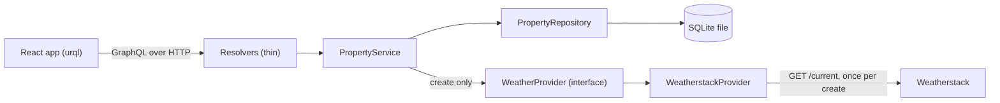

# US Property Records

This application keeps records of US properties. When a property is created, it stores the current weather, latitude and longitude returned for its location. The weather is a snapshot from creation, and queries never call Weatherstack.

1. Query all properties.
2. Sort properties by date of creation.
3. Filter the list by city, zip code and state.
4. Query the details of one property.
5. Add a property (all properties are in the US).
6. Delete a property.

## Run it

Use Node.js 24, as specified in `.nvmrc`. Create `.env` from `.env.example` and set `WEATHERSTACK_API_KEY` there. No Docker or cloud account is needed.

```sh
npm install
cp .env.example .env     # then put the Weatherstack key in .env
npm run dev              # API on http://localhost:4000/graphql (with GraphiQL), web on http://localhost:5173
npm run verify
npm run e2e
```

The local API with GraphiQL is at http://localhost:4000/graphql. The web app is at http://localhost:5173.

## Test it

`npm run verify` runs format check, codegen, lint, typecheck, unit and integration tests, and the web build.

```sh
npm run verify
```

`npm run e2e` runs Playwright.

```sh
npm run e2e
```

| Layer                  | What                                                                                                                            | How                                              |
| ---------------------- | ------------------------------------------------------------------------------------------------------------------------------- | ------------------------------------------------ |
| Input rules            | Valid and invalid inputs and filters, trimming                                                                                  | Vitest, pure functions                           |
| Weather adapter        | Success with string coordinates, mapped error codes, HTTP 429, 5xx, timeout, unreadable body, missing location, key never leaks | Vitest with a stub `fetch` and recorded fixtures |
| Service and repository | Create, list with every filter combination, both sort orders, delete, not found                                                 | Vitest, real SQLite in `:memory:`, fake provider |
| GraphQL API            | All six stories, error codes and field errors, failed weather stores nothing, zero-provider-calls proof                         | Vitest, in process through `yoga.fetch`, no port |
| Web                    | Form validation and error display, filter and sort to URL, list states, delete confirmation, empty-list refresh                 | Vitest, Testing Library, `msw`                   |
| End to end             | Six stories against the API, a temporary database and a local Weatherstack stub                                                 | Playwright                                       |
| Real service           | One create against Weatherstack, evidence saved without the key                                                                 | Manual                                           |

No test calls the real Weatherstack service.

## Environment variables

Configuration is parsed at start-up. A missing or malformed value stops the process with a message naming the variable, never its value.

| Variable                | Default                        | Notes                                                 |
| ----------------------- | ------------------------------ | ----------------------------------------------------- |
| `WEATHERSTACK_API_KEY`  | None, required                 | Never logged or committed                             |
| `WEATHERSTACK_BASE_URL` | `https://api.weatherstack.com` | Configurable so end-to-end tests can use a local stub |
| `WEATHER_TIMEOUT_MS`    | `5000`                         |                                                       |
| `PORT`                  | `4000`                         |                                                       |
| `DATABASE_PATH`         | `./data/properties.db`         | Git-ignored                                           |
| `LOG_LEVEL`             | `info`                         |                                                       |

## Example GraphQL operations

Each operation can be pasted into GraphiQL. Replace `REPLACE_WITH_REAL_ID` in the detail and delete examples with a real property id.

List all properties:

```graphql
query ListProperties {
  properties {
    id
    street
    city
    state
    zipCode
    createdAt
  }
}
```

Sort properties oldest first:

```graphql
query SortPropertiesOldestFirst {
  properties(sort: CREATED_AT_ASC) {
    id
    street
    city
    state
    zipCode
    createdAt
  }
}
```

Filter by city, state and zip code:

```graphql
query FilterProperties {
  properties(filter: { city: "Fountain Hills", state: AZ, zipCode: "85268" }) {
    id
    street
    city
    state
    zipCode
  }
}
```

Get one property's details:

```graphql
query GetPropertyDetails {
  property(id: "REPLACE_WITH_REAL_ID") {
    id
    street
    city
    state
    zipCode
    lat
    long
    weatherData {
      observation_time
      temperature
      weather_descriptions
    }
    createdAt
  }
}
```

Create a property:

```graphql
mutation AddProperty {
  createProperty(
    input: { street: "123 Example Road", city: "Fountain Hills", state: AZ, zipCode: "85268" }
  ) {
    id
    street
    city
    state
    zipCode
    lat
    long
    weatherData {
      observation_time
      temperature
      weather_descriptions
    }
    createdAt
  }
}
```

Delete a property:

```graphql
mutation DeleteProperty {
  deleteProperty(id: "REPLACE_WITH_REAL_ID") {
    id
    street
    city
    state
    zipCode
  }
}
```

## Architecture



1. Resolvers pass arguments to the service and translate domain errors into GraphQL errors.
2. `PropertyService` validates, fetches weather and persists; it depends on `WeatherProvider`, not `fetch`.
3. `PropertyRepository` is the only file that contains SQL.
4. `WeatherstackProvider` owns Weatherstack URL, query, response and error-code knowledge, and receives `fetch`, base URL, key and timeout through its constructor.
5. `main.ts` parses configuration, opens the database, builds the provider, repository and service, starts Yoga, and closes resources on `SIGINT` and `SIGTERM`, without a dependency-injection container.
6. Only `PropertyService.create` calls the provider; tests prove queries and delete make zero provider calls, while create makes exactly one.

## Stack and why

| Choice                                                                         | Reason                                                                                                         | Rejected                                                                                    |
| ------------------------------------------------------------------------------ | -------------------------------------------------------------------------------------------------------------- | ------------------------------------------------------------------------------------------- |
| Node 24                                                                        | Built-in SQLite and direct TypeScript execution                                                                | Node 22: `node:sqlite` is flagged experimental there                                        |
| npm workspaces: `apps/api`, `apps/web`, `e2e`                                  | Built into npm; one install and one lockfile                                                                   | pnpm or Turborepo: another tool for two packages                                            |
| TypeScript 6.0 with `strict`, `noUncheckedIndexedAccess`, `erasableSyntaxOnly` | Newest version the linter supports                                                                             | TypeScript 7: outside `typescript-eslint`'s range                                           |
| GraphQL Yoga 5 on `node:http`                                                  | Small, spec-compliant, error masking, health endpoint and GraphiQL built in, in-process `yoga.fetch` for tests | Apollo Server: more surface for six operations; Express: not needed                         |
| Schema-first SDL and graphql-codegen                                           | The SDL contract lets backend and frontend sessions work in parallel                                           | Code-first (Pothos, Nexus): the contract would be TypeScript inside the API package         |
| `node --watch --env-file=.env src/main.ts`                                     | No build step, `tsx` or `dotenv`                                                                               | `tsx` and a compiled `dist/`                                                                |
| Built-in `node:sqlite`, hand-written SQL in one repository file                | One table and five statements, no native addon, zero dependencies                                              | Drizzle or Prisma with `better-sqlite3`; Drizzle on `node:sqlite` is release-candidate only |
| Zod 4 at the two trust boundaries                                              | One library parses and types mutation input and Weatherstack responses                                         | Hand-written checks                                                                         |
| pino                                                                           | Structured lines, one dependency, redaction built in                                                           | `console.log`                                                                               |
| React 19, Vite 8, React Router 8                                               | Three routes with filters in the URL                                                                           | Next.js: a server is not needed                                                             |
| urql 5 with default document cache                                             | Small; mutations invalidate lists by type name; typed documents from codegen                                   | Apollo Client: normalised cache for six operations; TanStack Query: cache keys by hand      |
| Plain CSS with custom properties                                               | No UI kit                                                                                                      | Tailwind or a component library                                                             |
| Vitest 5, Testing Library and `msw` (node)                                     | One runner for both apps                                                                                       | Jest                                                                                        |
| Playwright, Chromium only                                                      | The six user stories as code                                                                                   | Cypress                                                                                     |
| ESLint, Prettier, `tsc --noEmit`, `npm run verify`                             | One command answers whether quality checks pass                                                                | None specified                                                                              |
| `concurrently`                                                                 | One `npm run dev` for API and web                                                                              | Two terminals                                                                               |

## Trade-offs and what comes next

- Editing a property, pagination and authentication are outside the six stories.
- Zip-to-city and state validation is omitted because the address is trusted as typed and Weatherstack region naming was measured for one state only.
- US territories are omitted because the state contract covers the 50 states and DC.
- Retries, caching and a circuit breaker are omitted to keep the weather call direct and because the quota is small.
- A migration tool is omitted because there is one schema version.
- A production API build, serving the web bundle from the API and deployment are omitted from this local application.
- `astro` and `air_quality` are not exposed because the contract only exposes the selected current-weather fields.
- Weather is a snapshot from creation and is never refreshed.
- `npm audit` reports 10 high findings, all through the transitive development dependency `braces`; they are left untouched.

To move to AWS Lambda, GraphQL Yoga's fetch-style handler would run the same schema and resolvers behind a Lambda function URL or API Gateway with a thin adapter in place of `main.ts`. Since a SQLite file does not survive between invocations, `PropertyRepository` would get a second implementation over a managed database while the service stayed unchanged. The key would move from `.env` to a secrets store, and the web bundle would be served as static files from object storage behind a CDN. This deployment is not built.

## How AI was used

| Role      | Who                                                 | Does                                                                                                     | Never                                              |
| --------- | --------------------------------------------------- | -------------------------------------------------------------------------------------------------------- | -------------------------------------------------- |
| Manager   | The manager session                                 | Plans, writes briefs, merges into `main`, verifies after each merge and maintains the record             | Implements                                         |
| Conductor | A background subagent per slice                     | Writes worker and reviewer prompts, runs `npm run verify`, reads the diff and decides on review findings | Implements                                         |
| Worker    | A worker model in its own worktree and slice branch | Writes tests and code inside its slice's files                                                           | Touches another slice's files or adds a dependency |
| Reviewer  | A model from another vendor than the worker         | Reads the diff and returns findings                                                                      | Writes code or reviews its own diff                |

One slice follows this loop:

1. The manager provides a brief.
2. The worker writes a test and shows it failing, then implements until it passes.
3. The conductor verifies the slice and asks the reviewer to inspect the diff.
4. The worker fixes findings, with at most three review rounds.
5. The conductor reports to the manager, who merges and verifies on `main`.

The project record lives in `docs/agent/`:

- `prompts/`: prompts with outcomes.
- `decisions-log.md`: decisions.
- `manager-state.md`: manager state.
- `briefs/`: slice briefs.
- `handoffs/`: handoff files for sessions.
- `slices/<slice>/`: worker and reviewer prompts with raw replies.
- `reviews/`: review records.
- `review-log.md`: review log.
- `session-metrics.md`: session metrics.
- `sessions/`: redacted transcripts.
- `skills/`: copies and descriptions of skills used.

`AGENTS.md` contains the rules agents follow, and `CLAUDE.md` imports those rules. `docs/SPEC.md` holds acceptance criteria in Given/When/Then form with ids, which tests use. `scripts/grok-review.mjs` sends diffs to the reviewer and saves raw replies. `scripts/export-sessions.ts` exports transcripts to redacted Markdown and has a test for banned phrases.

### Where an agent was wrong and how it was caught

This section is filled in wave 2 from the review logs under `docs/agent/reviews/` and the slice records.

## Skills

| Skill             | Status         | Reason                                                                                                                                             |
| ----------------- | -------------- | -------------------------------------------------------------------------------------------------------------------------------------------------- |
| `grilling`        | Copied         | Used to settle open plan decisions before approval.                                                                                                |
| `handoff`         | Copied         | Its document format models the conductor handoff files.                                                                                            |
| `conduct`         | Described only | Private repository; it supplied the manager, conductor, worker and reviewer roles.                                                                 |
| `conduct-binding` | Described only | Private repository; it bound the conduct workflow to the manager session, while project-specific equivalents are in `AGENTS.md` and handoff files. |
| `exo-compact`     | Described only | Private repository; it compacted the manager session while keeping earlier context searchable.                                                     |
| `i-have-adhd`     | Described only | Its public origin is inferred, not confirmed; a copy waits for the author's confirmation.                                                          |

The skill page, including provenance and copy details, is in [`docs/agent/skills/README.md`](docs/agent/skills/README.md).
