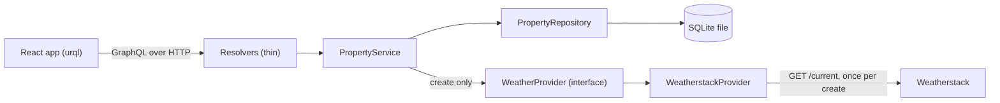

# Plan

Status: APPROVED by Marcin on 2026-10-13. Written by the manager session. The eight points that were open are settled as recommended and listed in section 19. A change to this file after approval goes through the manager and gets a row in the decisions log.

## 1. What we are building

A small full-stack application that keeps records of US properties.

- A person adds a property by typing its street, city, state and zip code. At that moment, and only at that moment, the backend asks Weatherstack for the current weather at that location and stores the answer with the property: the weather object, the latitude and the longitude.
- The person can list all properties, sort the list by creation date, filter it by city, state and zip code, open one property to see its details with the stored weather, and delete a property.
- The backend is a GraphQL API in TypeScript on Node.js. The frontend is React in TypeScript. Data lives in one SQLite file, so the application runs with `npm install` and nothing else: no Docker, no cloud account.
- The weather shown is a snapshot from the moment of creation. It is never refreshed, and no query ever calls Weatherstack.

The assessment grades four things: code quality, the choice of technology, completion of the scope, and the quality of the AI harness and prompts. So the repository also carries the full record of how it was built: every prompt, every decision, every review round, the rules the agents worked under, and redacted session transcripts.

The six user stories (the acceptance criteria per story go into `docs/SPEC.md` in wave 0):

1. Query all properties.
2. Sort properties by date of creation.
3. Filter the list by city, zip code and state.
4. Query the details of one property.
5. Add a property (all properties are in the US).
6. Delete a property.

## 2. Facts measured on 2026-10-13

Each one was run once on Marcin's machine (n=1, so provisional), Node 24.16.0, Windows 11.

| Fact | Result |
|---|---|
| Weatherstack over HTTPS with this key | Works (HTTP 200). The brief's worry that the free plan is HTTP only does not hold for this key. |
| Lookup by zip code `85268` | `request.type` "Zipcode", name "Fountain Hills", region "Arizona", country "USA", lat "33.609", lon "-111.724" |
| Lookup by `Fountain Hills, AZ` | `request.type` "City", name "Fountain Hills", region "Arizona", country "United States of America", lat "33.612", lon "-111.717". The API echoed the query as "Fountain Hills, United States of America": the state is not in the echo. |
| Types | `location.lat` and `location.lon` are strings. `current` has 18 keys; `weather_icons` and `weather_descriptions` are arrays, `astro` and `air_quality` are objects, `is_day` is a string. |
| Two calls back to back | The second returned HTTP 429 with `success: false`, error code 106 `rate_limit_reached`. |
| `node:sqlite` (built into Node) | Works with nothing printed on stderr: `STRICT` tables, `INSERT ... RETURNING`, `DELETE ... RETURNING`, millisecond timestamps as a column default, bundled SQLite 3.53.0. |
| Node runs TypeScript files directly | `node file.ts` works with no flag and no extra package. |
| Reviewer route | Grok 4.7 through the Cursor v1 API on a pasted diff: 3 of 3 planted defects found, 34 s (`docs/agent/reviews/grok-smoke.md`). |
| Package compatibility (from the npm registry) | `typescript-eslint` 8.71.2 accepts TypeScript below 6.1.0, so TypeScript 7.0.2 (the registry's latest) is out. `graphql-yoga` 5.24.4, the codegen packages and `msw` 3.0.3 accept `graphql` 17. Drizzle supports `node:sqlite` only in its 1.0 release candidate, not in the stable 0.45.4. |

The brief's example for this address is lat 33.609, long -111.729. The zip lookup matches the latitude exactly and the longitude to 0.005 degrees; the city lookup is further off on both.

## 3. Stack

Versions are the registry's latest on 2026-10-13 unless a compatibility range says otherwise. Wave 0 installs them; a combination that installs with a peer warning is reported to the manager, not forced.

| Concern | Choice | Why | Rejected |
|---|---|---|---|
| Runtime | Node 24 (`engines` and `.nvmrc`) | Built-in SQLite and direct TypeScript execution, both verified here | Node 22: `node:sqlite` is flagged experimental there |
| Repository | npm workspaces: `apps/api`, `apps/web`, `e2e` | Built into npm; one install, one lockfile | pnpm or Turborepo: another tool for three small packages |
| Language | TypeScript 6.0, `strict`, `noUncheckedIndexedAccess`, `erasableSyntaxOnly` | Newest version the linter supports | TypeScript 7: outside `typescript-eslint`'s range today |
| API | GraphQL Yoga 5 on `node:http` | Small, spec-compliant, error masking, health endpoint and GraphiQL built in, in-process `yoga.fetch` for tests | Apollo Server: more surface for the same six operations; Express: not needed |
| Schema | Schema-first SDL in one file, types generated with graphql-codegen for both apps | The SDL file is the contract that lets backend and frontend sessions work in parallel | Code-first (Pothos, Nexus): the contract would be TypeScript inside the API package |
| Running the API | `node --watch --env-file=.env src/main.ts` | No build step, no `tsx`, no `dotenv` | `tsx` and a compiled `dist/` |
| Database | SQLite through the built-in `node:sqlite`, hand-written SQL in one repository file | One table and five statements; no native addon to compile or to be blocked by Windows application control; zero dependencies | Drizzle or Prisma with `better-sqlite3`: a native addon and an ORM for one table; Drizzle on `node:sqlite`: release candidate only |
| Validation | Zod 4, at the two trust boundaries (mutation input, Weatherstack response) | One library for both boundaries; parses and types in one step | Hand-written checks |
| Logging | pino | Structured lines, one dependency, redaction built in | `console.log` |
| Web | React 19, Vite 8, React Router 8 | The brief's stack; three routes with filters in the URL | Next.js: a server we do not need |
| GraphQL client | urql 5 with its default document cache | Small; mutations invalidate lists by type name; typed documents from codegen | Apollo Client: a normalised cache for six operations; TanStack Query: cache keys by hand |
| Styling | Plain CSS with custom properties | No UI kit, nothing to explain | Tailwind or a component library |
| Unit and integration tests | Vitest 5; Testing Library and `msw` (node) for the web | One runner for both apps | Jest |
| End-to-end | Playwright, Chromium only | The six user stories as code | Cypress |
| Quality gates | ESLint (typescript-eslint, type-checked rules), Prettier, `tsc --noEmit`, one `npm run verify` | One command answers "is it green" | |
| Parallel dev processes | `concurrently` | One `npm run dev` for API and web | Two terminals in the README |

## 4. Architecture



Rules, each one explainable in a sentence:

1. Resolvers contain no logic. They pass arguments to the service and translate domain errors into GraphQL errors.
2. `PropertyService` holds the rules: validate, fetch weather, persist. It depends on the `WeatherProvider` interface, never on `fetch`.
3. `PropertyRepository` is the only file that contains SQL.
4. `WeatherstackProvider` is the only file that knows Weatherstack: the URL, the query format, the response shape, the error codes. It receives `fetch`, the base URL, the key and the timeout through its constructor, so tests pass a stub and no HTTP mocking library is needed in the API.
5. `main.ts` is the composition root: parse config, open the database, build provider, repository and service, start Yoga, close everything on `SIGINT` and `SIGTERM`. No dependency-injection container.
6. Only `PropertyService.create` calls the provider. A test proves that `properties`, `property` and `deleteProperty` make zero provider calls and that `createProperty` makes exactly one.

### Repository layout

```
AGENTS.md                 rules for every agent
CLAUDE.md                 one line: @AGENTS.md
README.md
package.json              workspaces, dev, verify, e2e
.env.example
.github/workflows/verify.yml
apps/api/
  schema.graphql          the contract
  codegen.ts
  src/
    main.ts               composition root
    config.ts             environment parsed with Zod
    db/database.ts        open the file, create the table
    property/
      property.ts              domain types
      property-input.ts        Zod rules for input and filter
      property-service.ts
      property-repository.ts
    weather/
      weather-provider.ts      the interface and its two error classes
      weatherstack-provider.ts
      weatherstack-response.ts Zod schema of the response
      fixtures/                recorded responses, key removed
    graphql/
      resolvers.ts
      errors.ts                domain error to GraphQL error
apps/web/
  codegen.ts
  src/
    main.tsx, App.tsx          client and routes
    graphql/                   documents and generated types
    pages/                     PropertyListPage, NewPropertyPage, PropertyDetailPage
    components/                PropertyFilters, PropertyTable, PropertyForm, WeatherCard, ConfirmDialog
    us-states.ts               code to name, typed against the schema enum
e2e/
  playwright.config.ts
  weatherstack-stub.ts         tiny HTTP server that serves a fixture
  stories.spec.ts
scripts/
  grok-review.mjs              send a diff to the reviewer, save the raw reply
  export-sessions.ts           transcripts to redacted Markdown, with its test
docs/
  plan.md, SPEC.md
  brief/                       the starting prompt (today `cover-tree.md`)
  agent/                       the record: prompts, decisions, slices, reviews, sessions
```

## 5. The contract: GraphQL schema

```graphql
type Query {
  "All properties, newest first unless asked otherwise. Never calls the weather service."
  properties(filter: PropertyFilter, sort: PropertySort! = CREATED_AT_DESC): [Property!]!
  "One property, or null when the id is unknown."
  property(id: ID!): Property
}

type Mutation {
  "Fetches current weather for the address once, then stores the property. Stores nothing if the weather call fails."
  createProperty(input: CreatePropertyInput!): Property!
  "Deletes and returns the property. Error PROPERTY_NOT_FOUND when the id is unknown."
  deleteProperty(id: ID!): Property!
}

type Property {
  id: ID!
  street: String!
  city: String!
  state: UsState!
  zipCode: String!
  lat: Float!
  long: Float!
  "Weather at the moment the property was created."
  weatherData: WeatherData!
  "ISO 8601, UTC, set by the database."
  createdAt: String!
}

"The `current` object of the Weatherstack response, field names unchanged."
type WeatherData {
  observation_time: String
  temperature: Float
  weather_code: Int
  weather_icons: [String!]
  weather_descriptions: [String!]
  wind_speed: Float
  wind_degree: Float
  wind_dir: String
  pressure: Float
  precip: Float
  humidity: Float
  cloudcover: Float
  feelslike: Float
  uv_index: Float
  visibility: Float
  is_day: String
}

input CreatePropertyInput {
  street: String!
  city: String!
  state: UsState!
  zipCode: String!
}

input PropertyFilter {
  "Whole name, case-insensitive."
  city: String
  state: UsState
  "Exactly five digits."
  zipCode: String
}

enum PropertySort { CREATED_AT_DESC CREATED_AT_ASC }

"The 50 states and DC."
enum UsState { AL AK AZ AR CA CO CT DE DC FL GA HI ID IL IN IA KS KY LA ME MD MA MI MN MS MO MT NE NV NH NJ NM NY NC ND OH OK OR PA RI SC SD TN TX UT VT VA WA WV WI WY }
```

Choices inside the schema:

- `UsState` as an enum: GraphQL itself rejects an unknown state, so the server needs no code for it, and the web select is typed against the same list.
- `WeatherData` as a typed object with Weatherstack's own field names: the brief says the field is the `current` object, so the names stay as they are and no mapping code exists. Every field is nullable because the set depends on the Weatherstack plan. The whole `current` object is stored, including `astro` and `air_quality`; those two are not exposed (some of their keys are expected to contain hyphens, which GraphQL field names cannot; unverified here).
- `sort` as one enum argument: a second sort key later is a new enum value, not a new argument.
- `createdAt` as a string: a custom scalar would add a dependency and validate nothing on output.
- `property` returns null for an unknown id (a lookup found nothing); `deleteProperty` raises an error (a requested change did not happen).

## 6. Data model

One table, created at start-up with `CREATE TABLE IF NOT EXISTS`.

```sql
CREATE TABLE IF NOT EXISTS property (
  id           TEXT PRIMARY KEY,
  street       TEXT NOT NULL,
  city         TEXT NOT NULL COLLATE NOCASE,
  state        TEXT NOT NULL CHECK (length(state) = 2),
  zip_code     TEXT NOT NULL CHECK (length(zip_code) = 5),
  lat          REAL NOT NULL,
  long         REAL NOT NULL,
  weather_data TEXT NOT NULL CHECK (json_valid(weather_data)),
  created_at   TEXT NOT NULL DEFAULT (strftime('%Y-%m-%dT%H:%M:%fZ', 'now'))
) STRICT;
CREATE INDEX IF NOT EXISTS property_city     ON property (city);
CREATE INDEX IF NOT EXISTS property_state    ON property (state);
CREATE INDEX IF NOT EXISTS property_zip_code ON property (zip_code);
```

- `id` is `crypto.randomUUID()`, generated in the repository.
- `created_at` is set by the database, with milliseconds. Sorting uses `created_at` and then `rowid`, so two rows from the same millisecond keep insertion order.
- `weather_data` is the `current` object as JSON text, stored whole.
- `zip_code` is text: zip codes have leading zeros.
- Statements: insert with `RETURNING *`, select by id, delete with `RETURNING *` (the deleted row and the not-found case in one statement), and the list. The list keeps only the predicates whose filter is set, composed inside the repository from fixed fragments (`city = :city`, `state = :state`, `zip_code = :zipCode`) joined with `AND`; every value is a bound parameter and nothing from a caller is concatenated into SQL. The sort direction is one of two fixed `ORDER BY` fragments, because a direction cannot be a bound parameter. A filter on one column must plan as a search on that column's index: the earlier form `(:city IS NULL OR city = :city)` was measured to scan the table for every list.
- No migration tool: there is one schema version. Listed in the deferrals.
- The same address may be stored twice. The brief asks for no uniqueness rule.

## 7. Behaviour

### Create

1. GraphQL checks types and the state enum.
2. The service validates with Zod: `street` and `city` trimmed, 1 to 200 and 1 to 100 characters; `zipCode` matches `^\d{5}$`.
3. The service calls `weatherProvider.getCurrentWeather(address)`. The adapter sends the zip code as the query and returns `{ lat, long, current }` with coordinates parsed to finite numbers.
4. The repository inserts one row. One `INSERT` is atomic on its own, so there is no transaction to manage.
5. If step 3 fails nothing is stored and the client gets a typed error. There is no retry: the quota is small and the person can press the button again.

### List, detail, delete

- Filter: `city` is compared whole and case-insensitively after trimming; `state` and `zipCode` exactly. An empty or blank filter value means "no filter". A zip filter that is not five digits is a `BAD_USER_INPUT` error, the same rule as on create.
- Default sort is newest first.
- Delete returns the deleted property.

### Errors

Every error the client is meant to handle carries `extensions.code`. Anything unexpected is masked by Yoga as `INTERNAL_SERVER_ERROR` with no stack trace, and logged on the server.

| Code | When | Extra |
|---|---|---|
| `BAD_USER_INPUT` | Zod rejects input or filter | `extensions.fieldErrors: [{ field, message }]` |
| `PROPERTY_NOT_FOUND` | `deleteProperty` with an unknown id | |
| `LOCATION_NOT_FOUND` | Weatherstack does not know the location | |
| `WEATHER_UNAVAILABLE` | Timeout, network failure, non-2xx, rate limit or quota, invalid key, unreadable or unexpected response | The reason goes to the log only |

## 8. Weatherstack adapter

- Request: `GET {WEATHERSTACK_BASE_URL}/current?access_key=...&query={zipCode}`, with `AbortSignal.timeout(WEATHER_TIMEOUT_MS)`.
- The response is parsed with a Zod schema before anything is trusted: either `{ success: false, error: { code, type } }` or `{ location: { lat, lon }, current: {...} }`. Unknown keys inside `current` are kept.
- A body with `success: false` is a failure at any HTTP status: the adapter reads the body before the status, and the error code in the body decides. Mapping: code 615 (`request_failed`, seen here with HTTP 400 when the fixtures were recorded) becomes `LOCATION_NOT_FOUND`; 104 and 106 (106 seen here with HTTP 429), 101, 105 and everything else become `WEATHER_UNAVAILABLE`.
- The key travels in the query string, because that is the only way Weatherstack accepts it. So the adapter never logs or throws a URL: log lines carry the outcome, the error code and the duration. A test drives the adapter through every failure with a marker key and asserts that the marker appears in no log line and in no error.
- Fixtures: the weather slice records two real responses once (a known zip and an unknown one), removes the key, and tests against the files. Calls spent so far: 5 (3 during planning, 2 for the fixtures on 2026-10-13). Budget for the rest of the project: 2 for the final manual run. No test, no dev loop and no CI job calls the real API.

## 9. Configuration and secrets

Parsed once at start-up with Zod; a missing or malformed value stops the process with a message that names the variable and never its value.

| Variable | Default | |
|---|---|---|
| `WEATHERSTACK_API_KEY` | none, required | never logged, never committed |
| `WEATHERSTACK_BASE_URL` | `https://api.weatherstack.com` | configurable so the end-to-end suite can point it at a local stub |
| `WEATHER_TIMEOUT_MS` | `5000` | |
| `PORT` | `4000` | |
| `DATABASE_PATH` | `./data/properties.db` | git-ignored |
| `LOG_LEVEL` | `info` | |

`.env` is loaded by Node's own `--env-file`. `.env.example` is committed.

## 10. Frontend

Three routes.

- `/`: the list. A filter form (city text, state select with "Any", zip code) applied on submit, a sort control (newest first, oldest first), and a table with street, city, state, zip code, creation time, temperature and description. Filters and sort live in the URL, so a filtered view can be linked and the back button works. Each row links to the detail page and has a delete button with a confirmation in a native `<dialog>`.
- `/properties/new`: the form. Native constraints (`required`, `pattern`, `maxlength`) catch the obvious before a request; server field errors are shown under their fields; weather errors are shown as one alert above the form with a sentence per code. The submit button is disabled while the request runs. On success the app opens the detail page of the new property.
- `/properties/:id`: all fields, the coordinates, and a weather card labelled as the weather at creation with its observation time. Delete with confirmation returns to the list. An unknown id shows a not-found state.

Every data view has loading, empty and error states; the list distinguishes "no properties yet" from "nothing matches the filters". Labels are tied to inputs, errors are announced through `aria-live`, focus moves to the first invalid field.

urql detail that tests must cover: the list query is tagged with `additionalTypenames: ['Property']`, otherwise a create from an empty list does not refresh it.

The dev server proxies `/graphql` to the API, so there is no CORS configuration.

## 11. Tests

Each test name starts with the acceptance-criterion id from `docs/SPEC.md`.

| Layer | What | How |
|---|---|---|
| Input rules | Valid and invalid inputs and filters, trimming | Vitest, pure functions |
| Weather adapter | Success with string coordinates, `success: false` for each mapped code, HTTP 429, 5xx, timeout, unreadable body, missing location, key never leaks | Vitest with a stub `fetch` and recorded fixtures |
| Service and repository | Create, list with every filter combination, both sort orders, delete, not found | Vitest, real SQLite in `:memory:`, fake provider |
| GraphQL API | All six stories through `yoga.fetch`, error codes and `fieldErrors`, failed weather stores nothing, the zero-provider-calls proof | Vitest, in process, no port |
| Web | Form validation and error display, filter and sort to URL, list states, delete confirmation, empty-list refresh | Vitest, Testing Library, `msw` |
| End to end | The six stories in a browser against the real API, a temporary database and a local Weatherstack stub | Playwright |
| Real service | One create against the real Weatherstack at the end, by hand, evidence saved without the key | manual |

Every worker writes the test first and shows it red before the implementation. For the zero-provider-calls proof the worker shows it failing against a list resolver that deliberately calls the provider, then removes the call. The red output goes into the slice record.

`npm run verify` runs format check, codegen, lint, typecheck, unit and integration tests, and the web build. `npm run e2e` runs Playwright. CI runs both; it can only be seen running after Marcin publishes the repository.

## 12. Running it

```
npm install
cp .env.example .env     # then put the Weatherstack key in .env
npm run dev              # API on http://localhost:4000/graphql (with GraphiQL), web on http://localhost:5173
npm run verify
npm run e2e
```

Wave 2 proves this on a fresh clone in a temporary folder, not in the working checkout.

## 13. The AI harness in the repository

- `AGENTS.md`: project overview, commands, the architecture rules of section 4, coding standards, definition of done, the never-do list (the key, pushing, complexity without a reason). `CLAUDE.md` imports it, so Claude and Codex read the same rules.
- `docs/SPEC.md`: acceptance criteria in Given/When/Then form with ids, the source for tests.
- `docs/agent/`: one home for the whole record, in the format of the reference project: `prompts/` (verbatim, with outcomes), `decisions-log.md`, `manager-state.md`, `briefs/` and `handoffs/` per slice, `slices/<slice>/` (each worker and reviewer prompt with its raw reply), `reviews/`, `review-log.md`, `session-metrics.md`, `sessions/` (redacted transcripts).
- `scripts/grok-review.mjs`: the reviewer call as a script, so every conductor uses the same request and saves the raw reply.
- `scripts/export-sessions.ts`: transcripts to Markdown with redaction, and a test with a list of banned phrases that is seen red first.
- Not created: subagent definitions, slash commands, hooks or MCP servers that the work does not use. The brief's draft asks for `docs/ai/`, `docs/DECISIONS.md` and `.claude/agents/`; this plan keeps one decisions log and one record folder instead of two of each.

## 14. Orchestration

| Role | Who | Does | Never |
|---|---|---|---|
| Manager | this session, Claude Opus 5.5 | plan, briefs, merges into `main`, verify after each merge, the record | implements |
| Conductor | one Claude Opus 5.5 subagent of the manager session per slice, at medium effort, running in the background | writes the worker prompt and the reviewer prompt, runs `npm run verify` and reads the diff itself, decides on review findings | implements |
| Worker | GPT Luna through `codex exec`, one per slice, in its own worktree and branch `slice/<name>` | writes tests and code inside its slice's files | touches another slice's files, adds a dependency |
| Reviewer | Grok 4.7, high reasoning, through the Cursor v1 API | reads the diff pasted into the prompt, returns findings | writes code; is never the model that wrote the diff |

The loop of one slice: brief from the manager, worker prompt, worker round (test red, then green), conductor's own verification, reviewer round, fixes, at most three review rounds, report to the manager, merge with `git merge --no-ff`, `npm run verify` on `main`. A finding that is not fixed is recorded with its reason.

Shared files: `package.json` files and the lockfile belong to the manager after wave 0. A worker that needs a dependency stops and asks.

Model ids are checked before every vendor leg and passed explicitly.

Conductors are started by the manager session as background subagents, one per slice, each pointed at the handoff file of its wave under `docs/agent/handoffs/` and at its own brief under `docs/agent/briefs/` (changed on 2026-10-13; before that the plan had Marcin start them from a terminal, each with a handoff of its own). A conductor writes its slice record under `docs/agent/slices/<slice>/` inside the slice worktree and commits it on the slice branch, so parallel conductors never share a git index; the record reaches `main` with the merge.

## 15. Waves

### Wave 0: foundation (serial, one session)

Everything two slices would otherwise both touch.

- Workspaces, TypeScript, ESLint, Prettier, Vitest configs, every dependency of this plan installed, `npm run verify`, `npm run dev`.
- `AGENTS.md`, `CLAUDE.md`, `docs/SPEC.md`, `.env.example`, the brief moved to `docs/brief/`.
- `apps/api/schema.graphql`, both codegen configs, generated types building.
- Signatures only, bodies throwing "not implemented": `WeatherProvider` and its error classes, `WeatherstackProvider`'s constructor, `PropertyService`, `PropertyRepository`, the domain types, `config.ts`. Wave 1 fills bodies and never changes a signature without the manager.
- `scripts/grok-review.mjs`, written first and used for this wave's own review.

Done when `npm run verify` is green on `main` and both apps start.

### Design step (alongside wave 0, Marcin with the manager)

How the frontend looks is settled in Claude Design before the `web` brief is written: the three screens of section 10 with their loading, empty and error states, and the tokens (colours, type, spacing). The result is saved under `docs/design/` and the `web` brief points at it. Section 10 stays the description of what the screens do; the design decides how they look, and may revisit the plain-CSS choice of section 3. Only the `web` slice waits for this step; the other four slices of wave 1 do not.

### Wave 1: five slices in parallel

| Slice | Owns | Delivers |
|---|---|---|
| `weather` | `apps/api/src/weather/**` | the adapter, the response schema, fixtures, its tests |
| `api` | `apps/api/src/{property,db,graphql}/**`, `main.ts`, `config.ts` | validation, service, repository, resolvers, error mapping, start-up and shutdown, API tests with a fake provider |
| `web` | `apps/web/**` | the three pages, components, documents, web tests on a mocked API |
| `transcripts` | `scripts/export-sessions.ts`, its test, `docs/agent/sessions/**`, `session-metrics.md` | export, redaction with the red-first test, metrics |
| `docs` | `README.md`, the architecture diagram, the AI workflow section | a draft from this plan, finished in wave 2 |

No slice depends on another's code: `api` tests against a fake provider, `web` against `msw`, `weather` against fixtures.

### Wave 2: integration (one or two sessions)

- `e2e`: `e2e/**` and `.github/**`. Starts as soon as `api` and `web` are merged.
- Closing, by the manager and one conductor: a Grok review of the whole diff, the fresh-clone run, the single real Weatherstack create with saved evidence, the final transcript export and the search for banned phrases, the README brought in line with what was built.

## 16. Cost

- Reviewer: about 22 calls expected (7 slices, up to 3 rounds each, plus the final review). The Cursor API returns no cost. Estimated from Grok 4.5's published price (2 USD per million input tokens, 6 per million output) at roughly 30 thousand tokens in and 5 thousand out per call: about 0.10 USD per call, 2 to 3 USD in total. Provisional; Grok 4.7's price was not found. Accepted by Marcin on 2026-10-13; a conductor stops and reports when a single call runs far longer than the trial call (34 seconds).
- Worker: `codex exec` on Marcin's Codex subscription; whether it is billed per call is not known to the manager.
- Weatherstack: free plan, 4 more calls planned.

## 17. Deferrals

Not built, each named in the README:

- Editing a property; pagination; authentication.
- Checking that the zip code belongs to the given city and state (the address is trusted as typed; Weatherstack's region naming is measured for one state only).
- US territories.
- Retries, caching or a circuit breaker around the weather call.
- A migration tool.
- A production build of the API and serving the web bundle from it; deployment. The README describes the path to AWS Lambda without building it.
- Exposing `astro` and `air_quality`.

## 18. Definition of done

1. A fresh clone runs with the four commands of section 12, and `npm run verify` and `npm run e2e` are green there.
2. Each of the six stories works in the UI and through GraphQL; the README has example operations.
3. The test that queries never call the weather provider exists and has been seen red.
4. A failed weather call stores nothing and returns a typed error; shown by a test.
5. One real create against Weatherstack succeeded; evidence saved without the key.
6. The key value and every banned phrase are absent from the working tree and from the git history; shown by a search whose pattern is first proven to hit a planted sample.
7. Every slice has its prompts, raw replies and review rounds in `docs/agent/`, and every decision has a row in the decisions log.
8. The README covers what it is, the stack and why, how to run and test, environment variables, the architecture diagram, trade-offs, what comes next, and how AI was used, including where an agent was wrong and how it was caught.
9. Nothing is pushed. Marcin publishes.

## 19. Questions settled at approval

All eight were answered by Marcin on 2026-10-13 as recommended. The input owed for P7 arrived the same day: public are grilling, i-have-adhd, handoff, superpowers, gstack, graphify and demo-video; private are conduct, conduct-binding and exo-compact.

| Id | Question | Decided |
|---|---|---|
| P1 | Database access: the SQLite built into Node with hand-written SQL, or an ORM with a native addon | Built-in. One table, five statements, nothing to compile or to be blocked on Windows. |
| P2 | Run the API's TypeScript directly with Node 24, or add `tsx` and a build step | Directly. Costs: Node 24 is required, and imports carry the `.ts` extension. |
| P3 | `weatherData` as a typed object with Weatherstack's field names, as an untyped JSON scalar, or typed with camelCase names | Typed, names unchanged. |
| P4 | `state` as an enum of 50 states and DC, or a string checked in code | Enum. |
| P5 | Ask Weatherstack by zip code or by "city, state" | Zip code: closer to the brief's example coordinates, and the API dropped the state from the city query. |
| P6 | One record folder (`docs/agent/`) and one decisions log, or the second set the brief's draft names (`docs/ai/`, `docs/DECISIONS.md`, `.claude/agents/`) | One. |
| P7 | Copies of the skills used in the work: commit them, or describe them with their source | Commit the public ones, describe the private ones. Split confirmed by Marcin on 2026-10-13 (see above). |
| P8 | Reviewer cost of section 16 | Estimate accepted; stop and report if a single call runs far longer than the trial. |
